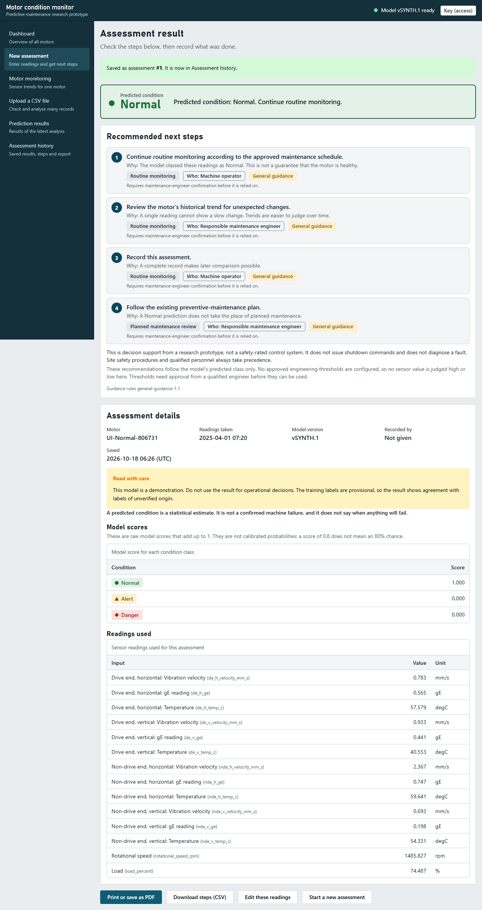
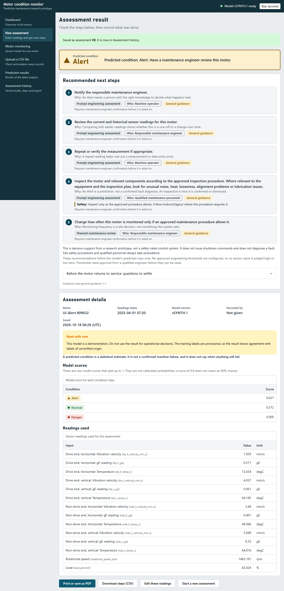
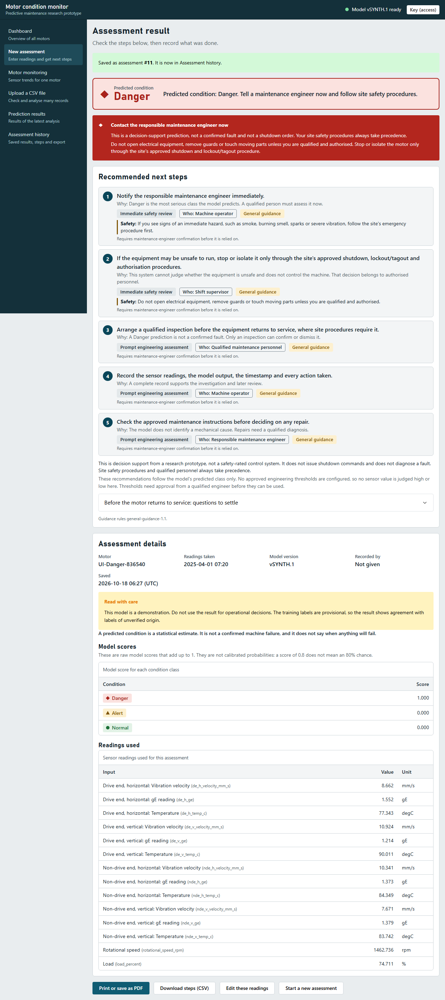
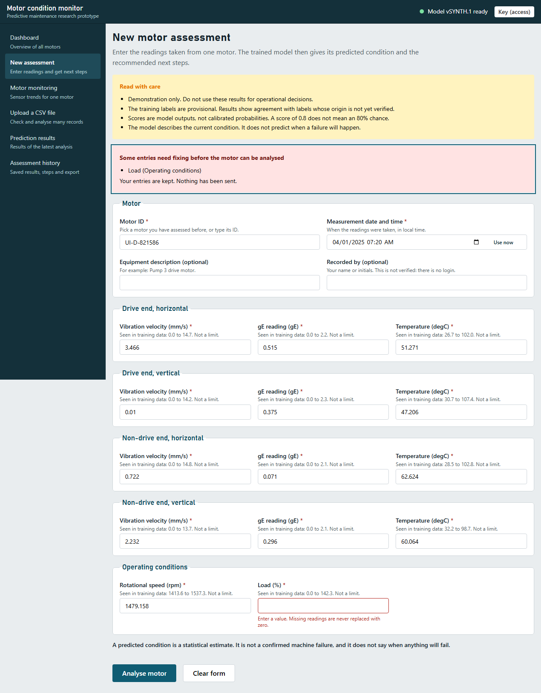
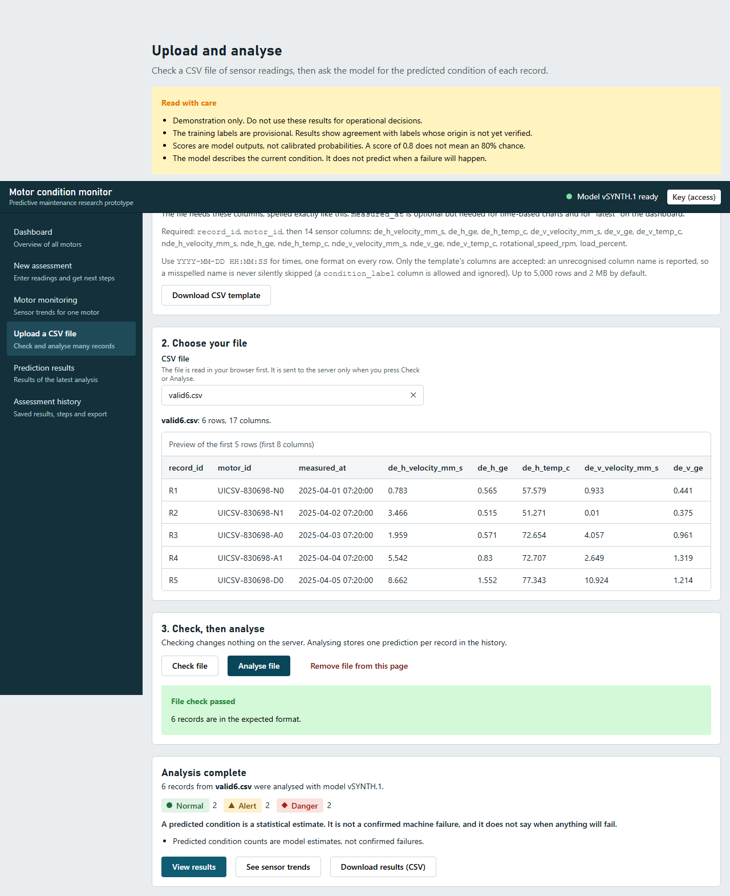
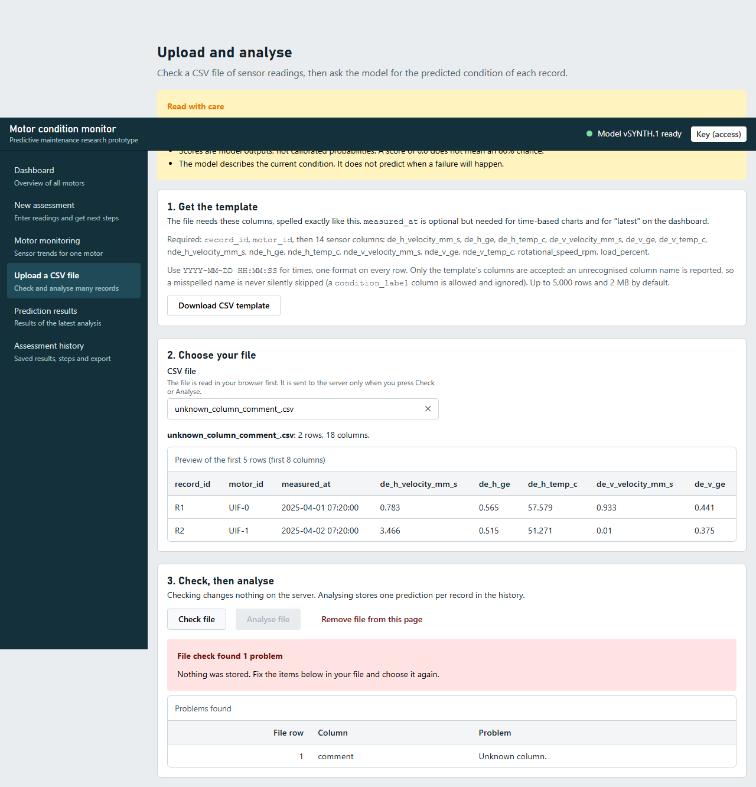
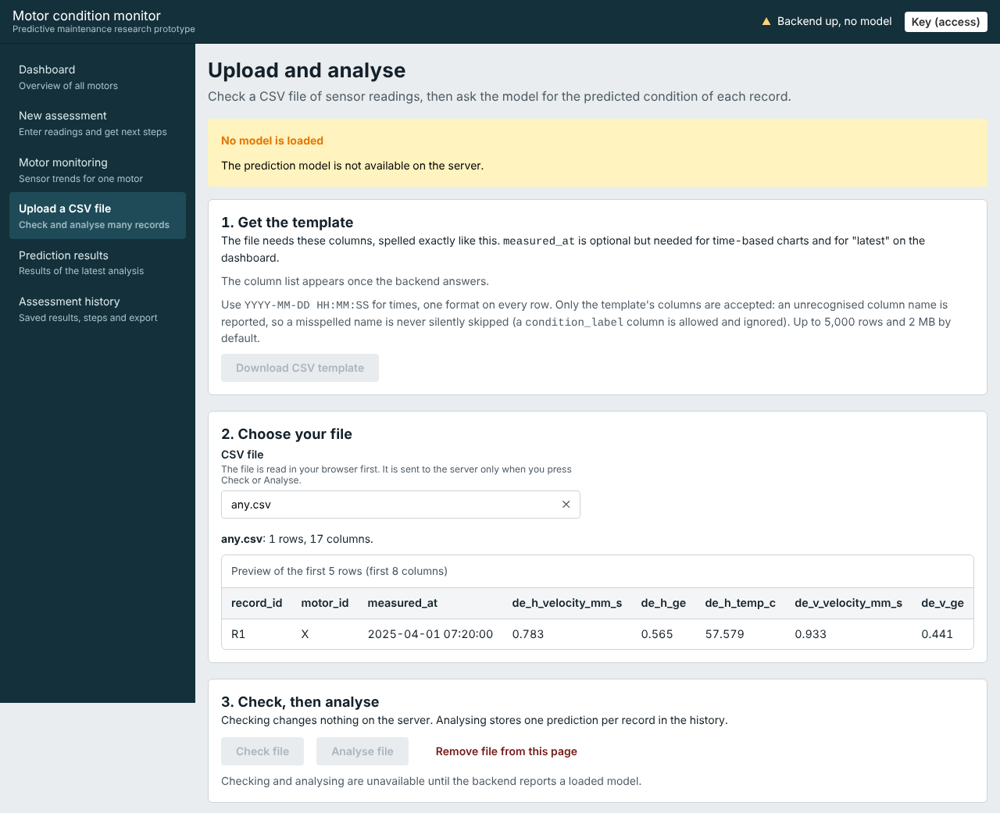
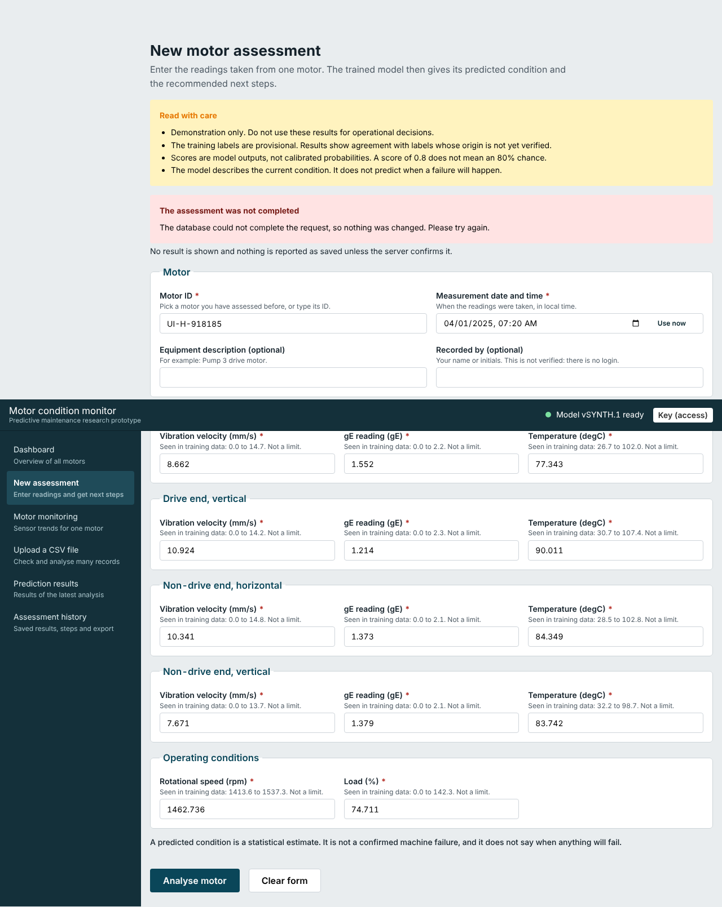
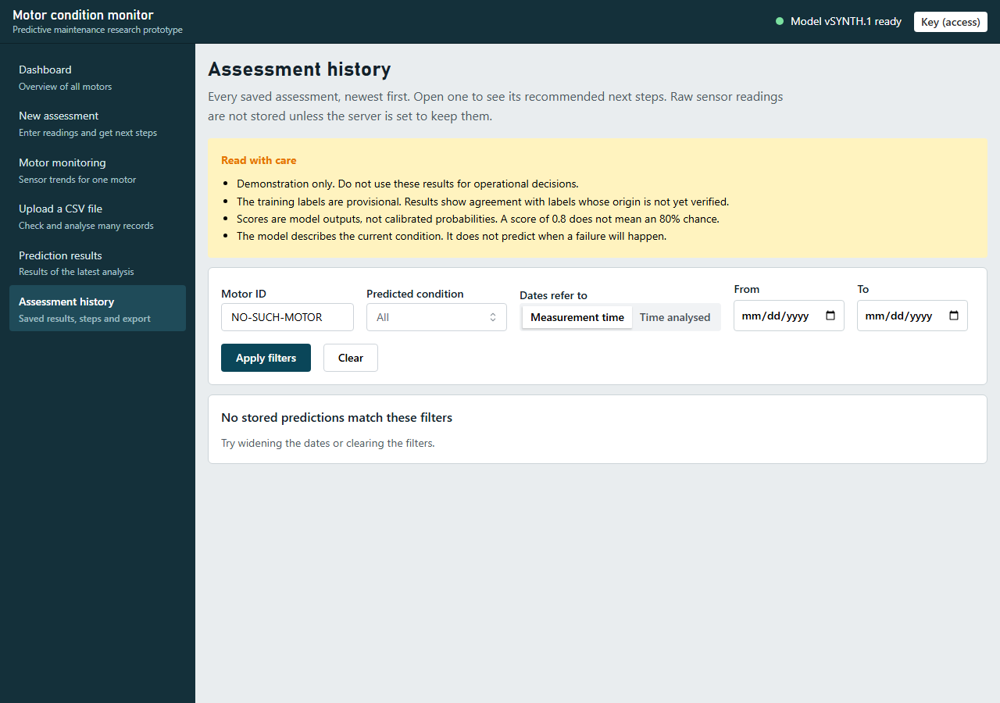
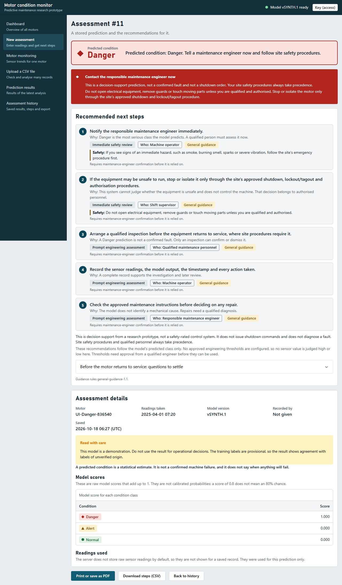

# End-to-end test report: sensor entry or CSV → validation → model → recommendations → database → history → export

Generated 2026-10-18 11:57 from `tests/e2e_full/out/results_*.json`. Every status below was produced by a test that was executed; nothing is copied from a plan.

## 1. Result

| Status | Count |
|---|---|
| BLOCKED | 1 |
| FAIL | 2 |
| KNOWN GAP | 1 |
| PASS | 32 |

- **PASS** = executed and every assertion held. **FAIL** = executed and an assertion broke. **BLOCKED** = could not run (needs the real trained model or real data). **KNOWN GAP** = a defect that is documented and expected to fail (a strict xfail: it turns into a failure the day it is fixed).

## 2. What was and was not tested

| Layer | What it proves | Model used |
|---|---|---|
| API + database (pytest, real uvicorn server, real SQLite file) | validation, scoring, recommendations, persistence, history, export, failure handling | Neural network **trained by `synthetic_model.py` on synthetic data** (learned, never hand-set; 97.9 % held-out accuracy). Samples are picked by their synthetic truth label; the expected answer comes from an independent NumPy forward pass |
| Browser (Playwright, Chromium, frontend build against that server) | what the screen shows equals the API response and the database row; frontend validation; failure messages; downloads | same |
| Recommendation rules (pytest) | rules for each class, unknown class, rules with a **controlled test double** for the scorer (`mock_ml`) | double, labelled |
| Real artefacts (E2E-B1, B2) | the real exported model and real readings | **BLOCKED**: `ml/artifacts/<bundle>` and real readings are not in this workspace |

**Not executed:** anything on the real model or real sensor data; Windows (the suite is cross-platform Python/Node, but was run on Linux); Firefox/Safari; PostgreSQL. The synthetic model proves the *pipeline*, not the quality of your real model.

## 3. Defects found and fixed during this task

| # | Defect | Severity | Fix | Re-test |
|---|---|---|---|---|
| E1 | Upload page said *“Extra columns are ignored”* but the backend rejects unknown columns (only `condition_label` is ignored), so a user could believe a misspelled column was harmless | Medium | `UploadPage.tsx` hint rewritten to match backend | E2E-CSV1, E2E-F, UI-F, Vitest |
| E2 | An export with no matching rows had a different header from a populated export (the `model_score_*` columns were missing) | Medium | `routes_history.py` seeds score columns from the loaded model | E2E-L (and a mutation check: removing the fix makes E2E-L fail) |
| E3 | *(test-quality, not product)* E2E-A had a vacuous assertion (`… or True`) and the chain did not compare stored steps with the rule table; a mutation that dropped the last step before saving was not caught by B and C | – | assertion removed; chain now compares returned steps with the rule table | the mutation now fails A, B and C |

**Known gap kept open:** R1 – `/api/predict/batch` has no idempotency, so uploading the same CSV twice stores the rows twice (E2E-I2, strict xfail). Not fixed because it needs a design decision (file hash, per-row key).

**Observations (by design, not defects):** CSV rows store no recommendation JSON (regenerated on read, flagged); sensor readings are not stored unless `STORE_INPUT_READINGS=true`; an unknown condition filter returns an empty list; manual assessments sent without an Idempotency-Key are stored each time; `motor_id` may not contain `=`.

## 4. Scenario table

| Test ID | Scenario | Status | Layer |
|---|---|---|---|
| E2E-A | A: Valid readings, Normal prediction: manual entry → model → recommendations → database → history → export | **PASS** | Model integration (trained synthetic model) |
| E2E-B1 | A-C (real): REAL trained model: bundle loads, parity probes pass, health and model-info are ready | **PASS** | Real artifacts |
| E2E-B2 | A-C (real): REAL model on REAL labelled rows: which classes does it actually produce, and does every saved record match? | **BLOCKED** | Real artifacts |
| E2E-R1 | A-C (rules): Recommendation rules for Normal, Alert and Danger, tested in isolation | **PASS** | Recommendation rules (no model) |
| E2E-R2 | A-C (rules): Recommendation rules: unknown class is never given invented advice | **PASS** | Recommendation rules (no model) |
| E2E-R3 | A-C (rules): Rules → API → database: recommendations stored equal the rules' output for each class (model replaced by a TEST DOUBLE) | **PASS** | Recommendation rules (TEST DOUBLE model) |
| UI-A | A: Manual entry in the browser, Normal case: what the screen shows equals the backend answer and the saved database record | **PASS** | Frontend + backend + database (trained synthetic model) |
| UI-FID | A-C: The screen shows what the BACKEND returns, not a value of its own | **PASS** | Frontend + backend + database (trained synthetic model) |
| E2E-B | B: Valid readings, Alert prediction: full chain | **PASS** | Model integration (trained synthetic model) |
| UI-B | B: Manual entry in the browser, Alert case: what the screen shows equals the backend answer and the saved database record | **PASS** | Frontend + backend + database (trained synthetic model) |
| E2E-C | C: Valid readings, Danger prediction: full chain | **PASS** | Model integration (trained synthetic model) |
| UI-C | C: Manual entry in the browser, Danger case: what the screen shows equals the backend answer and the saved database record | **PASS** | Frontend + backend + database (trained synthetic model) |
| E2E-D | D: Missing required sensor readings | **PASS** | Model integration |
| UI-D | D: Missing sensor readings: the form refuses to send and says which fields | **PASS** | Frontend + backend + database (trained synthetic model) |
| E2E-E | E: Invalid numeric values and timestamps | **PASS** | Model integration |
| UI-E | E: Invalid numeric values and timestamps are stopped in the browser (and the backend independently refuses them, see E2E-E) | **PASS** | Frontend + backend + database (trained synthetic model) |
| E2E-CSV1 | F: Valid CSV: batch prediction, database rows, history and export | **PASS** | Model integration (trained synthetic model) |
| E2E-F | F: CSV with missing or incorrectly named columns | **PASS** | Model integration |
| UI-CSV | F: Valid CSV in the browser: preview, check, analyse; the results page, history and the downloaded export agree with the database | **PASS** | Frontend + backend + database (trained synthetic model) |
| UI-F | F: CSV with missing or incorrectly named columns is rejected in the browser with a reason; nothing is stored | **PASS** | Frontend + backend + database (trained synthetic model) |
| E2E-G1 | G: Model artifact missing: server refuses to start (default) with a clear message | **PASS** | Model integration |
| E2E-G2 | G: Model unavailable but server allowed to start: health says so, assessments refused (503), history still readable | **PASS** | Model integration |
| E2E-G3 | G: Incompatible or corrupted artifacts are refused at startup | **PASS** | Model integration |
| UI-G | G: Model artifact unavailable: the browser says so and offers no assessment | **FAIL** | Frontend + backend + database (trained synthetic model) |
| E2E-H1 | H: Database failure while the backend is running | **PASS** | Model integration |
| E2E-H2 | H: Database unreachable at startup | **PASS** | Model integration |
| UI-H | H: Database failure: the browser must not show a result or claim it was saved | **FAIL** | Frontend + backend + database (trained synthetic model) |
| E2E-I | I: Repeated submission (double click, retry, replay) | **PASS** | Model integration |
| E2E-I2 | I: Same CSV file uploaded twice (known gap R1) | **KNOWN GAP** | Model integration |
| UI-I | I: Repeated submission from the browser: double click, and re-sending the identical readings, create exactly one record | **PASS** | Frontend + backend + database (trained synthetic model) |
| E2E-J | J: History query for an unknown motor ID (and other unknown ids) | **PASS** | Model integration |
| UI-J | J: History page for an unknown motor ID | **PASS** | Frontend + backend + database (trained synthetic model) |
| E2E-K | K: A saved prediction is retrieved from history, also after the server is restarted | **PASS** | Model integration |
| UI-K | K: A prediction saved from the form is found in History and its detail page shows the same condition, scores and steps as when it was made | **PASS** | Frontend + backend + database (trained synthetic model) |
| E2E-L | L: Result export contains the expected records and columns | **PASS** | Model integration |
| UI-L | L: Export from the History page: expected records and columns for a filtered selection | **PASS** | Frontend + backend + database (trained synthetic model) |

## 5. Details per scenario

### E2E-A – Valid readings, Normal prediction: manual entry → model → recommendations → database → history → export

- **Status:** PASS
- **Preconditions:** Server running on a trained synthetic-data bundle; empty or any DB; held-out synthetic row whose TRUTH label is Normal
- **Test input:** 14 readings of a held-out Normal-labelled synthetic motor, motor id, timestamp, Idempotency-Key
- **Expected behaviour:** 201; condition equals independent NumPy reference; scores equal to 1e-6; routine-monitoring advice; 1 DB row identical to the response; retrievable by id, in history and in the export
- **Actual behaviour:** truth label (synthetic) = Normal; model returned Normal (independent NumPy reference agrees); scores {'Normal': 1.0, 'Alert': 0.0, 'Danger': 0.0} \| Normal advice: Predicted condition: Normal. Continue routine monitoring.
- **Evidence:** sqlite row id=1: condition=Normal, recommendations JSON == API response, summary='Normal: 4 recommended actions. First: Continue routine monitoring acco…', readings NOT stored (privacy default) \| GET /assessments/{id}, GET /predictions?motor_id and the CSV export all show the same condition, scores and recommendation summary as the database · test: `test_e2e_api_db.py::test_A_normal`
- **Defect severity if it fails:** High (wrong or unsaved prediction)
- **Corrective action:** Compare backend vs reference scores, then check preprocessing.json order; inspect the sqlite row

### E2E-B1 – REAL trained model: bundle loads, parity probes pass, health and model-info are ready

- **Status:** PASS
- **Preconditions:** Colab export copied to ml/artifacts/<bundle> (or PM_REAL_BUNDLE_DIR set)
- **Test input:** start backend on the real bundle
- **Expected behaviour:** server starts (manifest hashes, feature order, parity probes verified); /api/health model_ready=true
- **Actual behaviour:** bundle pm_condition_ann_v1.0.0 loaded: version v1.0.0, 14 features, classes ['Normal', 'Alert', 'Danger']
- **Evidence:**  · test: `test_recommendation_rules.py::test_B1_real_bundle`
- **Defect severity if it fails:** High
- **Corrective action:** Export the bundle from the Colab notebook (section 19) into ml/artifacts

### E2E-B2 – REAL model on REAL labelled rows: which classes does it actually produce, and does every saved record match?

- **Status:** BLOCKED (BLOCKED: needs the real bundle (ml/artifacts) and PM_REAL_SAMPLES_CSV pointing to real rows with a condition_label column.)
- **Preconditions:** Real bundle AND a CSV of real rows with the 14 inputs plus condition_label (PM_REAL_SAMPLES_CSV). The data stays on your machine
- **Test input:** up to 3 rows per true class, sent as manual assessments
- **Expected behaviour:** 201 each; DB row equals response; recommendations match the predicted class. Agreement with the label is REPORTED, not asserted (this is not an accuracy test)
- **Actual behaviour:** BLOCKED: needs the real bundle (ml/artifacts) and PM_REAL_SAMPLES_CSV pointing to real rows with a condition_label column.
- **Evidence:**  · test: `test_recommendation_rules.py::test_B2_real_rows`
- **Defect severity if it fails:** High
- **Corrective action:** Provide the real rows (never commit them to GitHub)

### E2E-R1 – Recommendation rules for Normal, Alert and Danger, tested in isolation

- **Status:** PASS
- **Preconditions:** No model involved: the rule function is called with each class name
- **Test input:** recommend('Normal' \| 'Alert' \| 'Danger')
- **Expected behaviour:** Normal: routine monitoring and planned-maintenance items only. Alert: escalation to the maintenance engineer + qualified inspection. Danger: urgent, immediate engineer notification, stop/isolate ONLY via approved lockout/tagout, no shutdown order, no repair instructions for unqualified users; never an invented deadline, threshold, part or diagnosis
- **Actual behaviour:** Normal: 4 items, only routine/planned timing, not urgent; Alert: 5 items, first = 'Notify the responsible maintenance engineer.'; Danger: 5 items, urgent, first = 'Notify the responsible maintenance engineer immediately.'; no invented deadline/threshold/part/diagnosis in any class
- **Evidence:**  · test: `test_recommendation_rules.py::test_R1_rules`
- **Defect severity if it fails:** Critical (safety wording)
- **Corrective action:** Edit services/recommendations.py, bump RULESET_VERSION, update docs/recommendation-rules.md

### E2E-R2 – Recommendation rules: unknown class is never given invented advice

- **Status:** PASS
- **Preconditions:** No model involved
- **Test input:** recommend('Critical')
- **Expected behaviour:** available=false, no items, tells the user to ask the maintenance engineer
- **Actual behaviour:** available=false, 0 items, headline: No recommendation available for this predicted class.
- **Evidence:**  · test: `test_recommendation_rules.py::test_R2_unknown`
- **Defect severity if it fails:** High
- **Corrective action:** recommendations.recommend

### E2E-R3 – Rules → API → database: recommendations stored equal the rules' output for each class (model replaced by a TEST DOUBLE)

- **Status:** PASS
- **Preconditions:** In-process API with a real SQLite file; the scoring function is replaced by a controlled double that returns a chosen class (mock_ml)
- **Test input:** valid readings; double returns Normal, then Alert, then Danger
- **Expected behaviour:** response and database both carry exactly recommend(class); stored summary/ruleset match
- **Actual behaviour:** double returned ['Normal', 'Alert', 'Danger']; for each, API response == recommend(class) == database JSON
- **Evidence:**  · test: `test_recommendation_rules.py::test_R3_doubles_to_db`
- **Defect severity if it fails:** High
- **Corrective action:** Check routes_assessments / repository.create_assessment

### UI-A – Manual entry in the browser, Normal case: what the screen shows equals the backend answer and the saved database record

- **Status:** PASS
- **Preconditions:** Backend on the trained synthetic model + fresh SQLite file; frontend build pointing at it; held-out synthetic row with truth label Normal
- **Test input:** 14 readings typed into the form, motor id, timestamp, then 'Analyse motor'
- **Expected behaviour:** Banner word, 4-5 recommendation cards, safety notes and scores on screen == API response == sqlite row; condition == independent NumPy reference; 'not a confirmed failure' statement present; red notice only for Danger
- **Actual behaviour:** truth Normal; independent reference Normal; screen shows 'Normal' (assessment #1); API and database both say Normal
- **Evidence:** 4 recommendation cards on screen == API items == database JSON (4); 0 safety notes identical; scores on screen match the database to 3 decimals; screenshot FULL-UI-Normal-result.png · test: `suite_full.mjs`
- **Defect severity if it fails:** High
- **Corrective action:** Compare the three sources; if only the UI differs look in AssessmentResult.tsx, otherwise in the backend
- **Screenshot:** 

### UI-FID – The screen shows what the BACKEND returns, not a value of its own

- **Status:** PASS
- **Preconditions:** Form filled with a Danger-labelled row
- **Test input:** the backend response is altered in flight: predicted_condition 'Danger' → 'Normal', Danger score → 0.123
- **Expected behaviour:** banner shows Normal and the table shows 0.123 (the UI renders the response); with the real response the same inputs show Danger
- **Actual behaviour:** altered response shown as-is: banner 'Normal', Danger score on screen 0.123. (The urgent red notice follows the response's own 'urgent' flag.) Static scan found 0 comparisons of predicted_condition to a literal class in components/pages
- **Evidence:**  · test: `suite_full.mjs`
- **Defect severity if it fails:** High
- **Corrective action:** Look for hard-coded values in AssessmentResult / AssessPage

### E2E-B – Valid readings, Alert prediction: full chain

- **Status:** PASS
- **Preconditions:** As E2E-A, held-out row whose TRUTH label is Alert
- **Test input:** 14 readings of a held-out Alert-labelled synthetic motor
- **Expected behaviour:** 201; condition equals independent reference; inspection and maintenance-engineer escalation advice; DB row identical to response
- **Actual behaviour:** truth label (synthetic) = Alert; model returned Alert (independent NumPy reference agrees); scores {'Normal': 0.3725, 'Alert': 0.6274, 'Danger': 0.0002} \| Alert advice: Predicted condition: Alert. Have a maintenance engineer review this motor.
- **Evidence:** sqlite row id=2: condition=Alert, recommendations JSON == API response, summary='Alert: 5 recommended actions. First: Notify the responsible maintenanc…', readings NOT stored (privacy default) \| GET /assessments/{id}, GET /predictions?motor_id and the CSV export all show the same condition, scores and recommendation summary as the database · test: `test_e2e_api_db.py::test_B_alert`
- **Defect severity if it fails:** High
- **Corrective action:** As E2E-A

### UI-B – Manual entry in the browser, Alert case: what the screen shows equals the backend answer and the saved database record

- **Status:** PASS
- **Preconditions:** Backend on the trained synthetic model + fresh SQLite file; frontend build pointing at it; held-out synthetic row with truth label Alert
- **Test input:** 14 readings typed into the form, motor id, timestamp, then 'Analyse motor'
- **Expected behaviour:** Banner word, 4-5 recommendation cards, safety notes and scores on screen == API response == sqlite row; condition == independent NumPy reference; 'not a confirmed failure' statement present; red notice only for Danger
- **Actual behaviour:** truth Alert; independent reference Alert; screen shows 'Alert' (assessment #2); API and database both say Alert
- **Evidence:** 5 recommendation cards on screen == API items == database JSON (5); 1 safety notes identical; scores on screen match the database to 3 decimals; screenshot FULL-UI-Alert-result.png · test: `suite_full.mjs`
- **Defect severity if it fails:** High
- **Corrective action:** Compare the three sources; if only the UI differs look in AssessmentResult.tsx, otherwise in the backend
- **Screenshot:** 

### E2E-C – Valid readings, Danger prediction: full chain

- **Status:** PASS
- **Preconditions:** As E2E-A, held-out row whose TRUTH label is Danger
- **Test input:** 14 readings of a held-out Danger-labelled synthetic motor
- **Expected behaviour:** 201; condition equals independent reference; urgent=true; stop/isolate only via approved lockout/tagout procedure; no shutdown command; DB row identical to response
- **Actual behaviour:** truth label (synthetic) = Danger; model returned Danger (independent NumPy reference agrees); scores {'Normal': 0.0, 'Alert': 0.0, 'Danger': 1.0} \| Danger advice: Predicted condition: Danger. Tell a maintenance engineer now and follow site safety procedures.
- **Evidence:** sqlite row id=3: condition=Danger, recommendations JSON == API response, summary='Danger: 5 recommended actions. First: Notify the responsible maintenan…', readings NOT stored (privacy default) \| GET /assessments/{id}, GET /predictions?motor_id and the CSV export all show the same condition, scores and recommendation summary as the database · test: `test_e2e_api_db.py::test_C_danger`
- **Defect severity if it fails:** Critical (safety wording)
- **Corrective action:** As E2E-A; check recommendations.py

### UI-C – Manual entry in the browser, Danger case: what the screen shows equals the backend answer and the saved database record

- **Status:** PASS
- **Preconditions:** Backend on the trained synthetic model + fresh SQLite file; frontend build pointing at it; held-out synthetic row with truth label Danger
- **Test input:** 14 readings typed into the form, motor id, timestamp, then 'Analyse motor'
- **Expected behaviour:** Banner word, 4-5 recommendation cards, safety notes and scores on screen == API response == sqlite row; condition == independent NumPy reference; 'not a confirmed failure' statement present; red notice only for Danger
- **Actual behaviour:** truth Danger; independent reference Danger; screen shows 'Danger' (assessment #3); API and database both say Danger
- **Evidence:** 5 recommendation cards on screen == API items == database JSON (5); 2 safety notes identical; scores on screen match the database to 3 decimals; screenshot FULL-UI-Danger-result.png · test: `suite_full.mjs`
- **Defect severity if it fails:** High
- **Corrective action:** Compare the three sources; if only the UI differs look in AssessmentResult.tsx, otherwise in the backend
- **Screenshot:** 

### E2E-D – Missing required sensor readings

- **Status:** PASS
- **Preconditions:** Server running
- **Test input:** valid body with each of the 14 readings removed in turn; empty readings; a null reading; missing motor id; missing timestamp
- **Expected behaviour:** 422 (never 500); error names the missing feature; nothing is saved
- **Actual behaviour:** 14 single-field omissions + 4 other cases: all 422 with a named field; database row count unchanged (3)
- **Evidence:**  · test: `test_e2e_api_db.py::test_D_missing`
- **Defect severity if it fails:** High if a prediction is made from incomplete data
- **Corrective action:** Check validate_single_readings

### UI-D – Missing sensor readings: the form refuses to send and says which fields

- **Status:** PASS
- **Preconditions:** Form open; a baseline row count of the database
- **Test input:** each of the 14 readings left empty in turn (one at a time) and all left empty
- **Expected behaviour:** inline error and error summary naming the field; NO request to POST /api/assessments leaves the browser; database unchanged
- **Actual behaviour:** 14 single omissions: each shows exactly one listed problem and an inline error; 0 requests to the backend; database row count unchanged (3)
- **Evidence:**  · test: `suite_full.mjs`
- **Defect severity if it fails:** High
- **Corrective action:** assessmentForm.validateForm
- **Screenshot:** 

### E2E-E – Invalid numeric values and timestamps

- **Status:** PASS
- **Preconditions:** Server running
- **Test input:** readings: 'abc', '', true, [], {}, NaN, Infinity, -Infinity, 1e999, 400-digit integer; timestamps: 'not-a-date', '2025-13-45T00:00:00', '2025-02-30T10:00:00', '', null, 12345.5, year 0001, 9999-12-31T23:59:59-05:00
- **Expected behaviour:** 422 for every one (never 500); nothing saved; an extreme but finite value is accepted only with an out-of-range warning
- **Actual behaviour:** 22 invalid values/timestamps → all 422, 0 rows added. 250 degC (finite, outside training range) → 201 with an input warning, as designed (no engineering limits exist)
- **Evidence:**  · test: `test_e2e_api_db.py::test_E_invalid`
- **Defect severity if it fails:** High
- **Corrective action:** Check schemas.py validators

### UI-E – Invalid numeric values and timestamps are stopped in the browser (and the backend independently refuses them, see E2E-E)

- **Status:** PASS
- **Preconditions:** Form open
- **Test input:** letters, 1,5, NaN, Infinity, 1e999, 12abc, negative-looking text; empty timestamp; timestamp in the future
- **Expected behaviour:** inline message in plain words; no request sent; future time shows a warning but is allowed; database unchanged
- **Actual behaviour:** 8 invalid texts blocked with a plain message (e.g. abc → Enter a number such as 4.2 (digits only, no units or letters).); future time warns; empty time is an error; 0 requests sent; database unchanged
- **Evidence:**  · test: `suite_full.mjs`
- **Defect severity if it fails:** High
- **Corrective action:** assessmentForm.ts

### E2E-CSV1 – Valid CSV: batch prediction, database rows, history and export

- **Status:** PASS
- **Preconditions:** Server running; 6-row CSV: 2 held-out rows per class (chosen by truth label)
- **Test input:** CSV with 6 rows and the tolerated condition_label column
- **Expected behaviour:** 200; per-row condition equals independent reference; 6 DB rows with one batch id; class_counts add up; history and export contain them
- **Actual behaviour:** 6 rows → {'Normal': 2, 'Alert': 2, 'Danger': 2}; each condition equals the independent reference; 6 sqlite rows with batch_id; all 6 present in the export. Note: CSV rows store no recommendation JSON (regenerated on read, flagged)
- **Evidence:**  · test: `test_e2e_api_db.py::test_CSV_valid`
- **Defect severity if it fails:** High
- **Corrective action:** Check routes_predict.predict_batch

### E2E-F – CSV with missing or incorrectly named columns

- **Status:** PASS
- **Preconditions:** Server running
- **Test input:** CSV missing de_h_ge; CSV with 'de_h_velocity' instead of de_h_velocity_mm_s; upper-case header; duplicate header; empty file; header only; no header
- **Expected behaviour:** validate: valid=false and the issue names the column; batch: 4xx, never 5xx; nothing saved
- **Actual behaviour:** missing de_h_ge: validate 200, batch 422; unknown extra column 'comment': validate 200, batch 422; misnamed de_h_velocity: validate 200, batch 422; upper-case header: validate 200, batch 422; empty file: validate 422, batch 422; header only: validate 200, batch 422; no header: validate 200, batch 422; duplicate header → rejected; predictions and upload_batches tables unchanged
- **Evidence:**  · test: `test_e2e_api_db.py::test_F_csv_columns`
- **Defect severity if it fails:** High
- **Corrective action:** Check csv_io.parse_and_validate

### UI-CSV – Valid CSV in the browser: preview, check, analyse; the results page, history and the downloaded export agree with the database

- **Status:** PASS
- **Preconditions:** Upload page open
- **Test input:** 6-row CSV, 2 held-out rows per class (chosen by truth label)
- **Expected behaviour:** 5-row preview, 'File check passed', 6 results whose conditions equal the independent reference and the 6 new database rows
- **Actual behaviour:** results page and database rows agree with the reference for all 6 rows (Normal, Normal, Alert, Alert, Danger, Danger); export downloaded with 9 data rows and the 20 expected columns
- **Evidence:**  · test: `suite_full.mjs`
- **Defect severity if it fails:** High
- **Corrective action:** UploadPage / predict_batch
- **Screenshot:** 

### UI-F – CSV with missing or incorrectly named columns is rejected in the browser with a reason; nothing is stored

- **Status:** PASS
- **Preconditions:** Upload page open
- **Test input:** CSV missing de_h_ge; CSV with 'de_h_velocity'; CSV with an unknown extra column; header-only CSV
- **Expected behaviour:** plain explanation naming the column (local check or server check); 'Analyse file' stays disabled; no upload batch or prediction rows are created
- **Actual behaviour:** missing de_h_ge; misnamed de_h_velocity; unknown column 'comment': each rejected with a message naming the column; Analyse disabled; database unchanged
- **Evidence:**  · test: `suite_full.mjs`
- **Defect severity if it fails:** High
- **Corrective action:** UploadPage.tsx / csv_io.py
- **Screenshot:** 

### E2E-G1 – Model artifact missing: server refuses to start (default) with a clear message

- **Status:** PASS
- **Preconditions:** MODEL_BUNDLE_DIR points to a folder that does not exist; REQUIRE_MODEL_AT_STARTUP=true
- **Test input:** start backend
- **Expected behaviour:** process exits non-zero; log says STARTUP ABORTED and names the problem; no stack-trace with paths of secrets
- **Actual behaviour:** exit code 3; log: ERROR:    Application startup failed. Exiting.
- **Evidence:**  · test: `test_e2e_api_db.py::test_G1_missing`
- **Defect severity if it fails:** High
- **Corrective action:** Check ModelRegistry.load / lifespan

### E2E-G2 – Model unavailable but server allowed to start: health says so, assessments refused (503), history still readable

- **Status:** PASS
- **Preconditions:** REQUIRE_MODEL_AT_STARTUP=false, no bundle
- **Test input:** GET /api/health, /api/model-info, POST /api/assessments, GET /api/predictions
- **Expected behaviour:** health model_ready=false/degraded; POST 503 with a plain message; no row saved; history 200
- **Actual behaviour:** health=degraded/model_ready=False; POST → 503 'The prediction model is not available on the server.'; 0 rows; history 200
- **Evidence:**  · test: `test_e2e_api_db.py::test_G2_no_model`
- **Defect severity if it fails:** High
- **Corrective action:** Check require_bundle dependency

### E2E-G3 – Incompatible or corrupted artifacts are refused at startup

- **Status:** PASS
- **Preconditions:** Copies of the trained bundle damaged in 6 different ways
- **Test input:** (a) feature order in preprocessing.json swapped, manifest re-signed; (b) weights replaced by a network with the wrong input width, re-signed; (c) weights.npz altered, manifest NOT re-signed; (d) class_mapping with a 4th class, re-signed; (e) a required file deleted; (f) FAST_DEBUG smoke-test bundle
- **Expected behaviour:** every one: process exits non-zero with STARTUP ABORTED; never serves predictions from a damaged bundle
- **Actual behaviour:** a_feature_order: refused (ERROR:    Application startup failed. Exiting.); b_weight_shape: refused (ERROR:    Application startup failed. Exiting.); c_tampered_weights: refused (ERROR:    Application startup failed. Exiting.); d_extra_class: refused (ERROR:    Application startup failed. Exiting.); e_missing_file: refused (ERROR:    Application startup failed. Exiting.); f_smoke_test: refused (ERROR:    Application startup failed. Exiting.)
- **Evidence:**  · test: `test_e2e_api_db.py::test_G3_incompatible`
- **Defect severity if it fails:** Critical
- **Corrective action:** Check artifacts.load_bundle

### UI-G – Model artifact unavailable: the browser says so and offers no assessment

- **Status:** FAIL (no explanation: New motor assessment)
- **Preconditions:** Backend restarted with no model bundle (REQUIRE_MODEL_AT_STARTUP=false)
- **Test input:** open New assessment and Upload
- **Expected behaviour:** header 'no model'; New assessment explains that no prediction is made; no Analyse button; Upload cannot analyse; database unchanged
- **Actual behaviour:** no explanation: New motor assessment
- **Evidence:**  · test: `suite_full.mjs`
- **Defect severity if it fails:** High
- **Corrective action:** AssessPage / ModelNotice
- **Screenshot:** 

### E2E-H1 – Database failure while the backend is running

- **Status:** PASS
- **Preconditions:** Backend running with a real SQLite file; one assessment saved; then the predictions table is dropped underneath the server
- **Test input:** POST /api/assessments, GET /api/predictions, GET /api/health after the table disappears
- **Expected behaviour:** 503 database_unavailable with a plain message; response never claims saved=true; no SQL text or file path in the response; server keeps running
- **Actual behaviour:** after DROP TABLE: POST → 503 database_unavailable 'The assessment could not be saved, so nothing was recorded. Please try again.'; GET /predictions → 503; server still running; no SQL/path in body
- **Evidence:**  · test: `test_e2e_api_db.py::test_H1_db_failure`
- **Defect severity if it fails:** High (false 'saved' claim)
- **Corrective action:** Check DatabaseUnavailableError handlers

### E2E-H2 – Database unreachable at startup

- **Status:** PASS
- **Preconditions:** DATABASE_URL points to a folder that does not exist
- **Test input:** start backend
- **Expected behaviour:** process exits non-zero with a clear message; no password/URL echoed
- **Actual behaviour:** refused to start: ERROR:    Application startup failed. Exiting.
- **Evidence:**  · test: `test_e2e_api_db.py::test_H2_db_startup`
- **Defect severity if it fails:** Medium
- **Corrective action:** Check lifespan / session creation

### UI-H – Database failure: the browser must not show a result or claim it was saved

- **Status:** FAIL (EPERM, Permission denied: \\?\C:\Users\erand\Documents\pm-v2\predictive-maintenance-system\tests\e2e_full\out\ui.db '\\?\C:\Users\erand\Documents\pm-v2\predictive-maintenance-system\tests\e2e_full\out\ui.db')
- **Preconditions:** Backend restarted on the trained bundle; then the predictions table is dropped under the running server
- **Test input:** fill the form and press Analyse; then open History
- **Expected behaviour:** 'The assessment was not completed' + 'nothing is reported as saved'; no result banner; History shows an error with Try again; entries kept
- **Actual behaviour:** EPERM, Permission denied: \\?\C:\Users\erand\Documents\pm-v2\predictive-maintenance-system\tests\e2e_full\out\ui.db '\\?\C:\Users\erand\Documents\pm-v2\predictive-maintenance-system\tests\e2e_full\out\ui.db'
- **Evidence:**  · test: `suite_full.mjs`
- **Defect severity if it fails:** High
- **Corrective action:** AssessPage error path / error handlers
- **Screenshot:** 

### E2E-I – Repeated submission (double click, retry, replay)

- **Status:** PASS
- **Preconditions:** Server running
- **Test input:** same Idempotency-Key + same readings twice; same key + different readings; 8 concurrent identical requests; no key twice; same CSV uploaded twice
- **Expected behaviour:** same key+payload → one row, second answer 200 duplicate=true with the same id; same key, different payload → 409; 8 concurrent → exactly 1 row; KNOWN GAP: same CSV twice stores twice
- **Actual behaviour:** same key twice: 201 then 200 duplicate=true, 1 row; same key different data: 409; 8 concurrent: 8 replies [200, 201], 1 row; WITHOUT a key two identical submissions → 2 rows (by design; the web form always sends a key)
- **Evidence:**  · test: `test_e2e_api_db.py::test_I_repeat`
- **Defect severity if it fails:** Medium
- **Corrective action:** Add idempotency to /predict/batch (risk R1)

### E2E-I2 – Same CSV file uploaded twice (known gap R1)

- **Status:** KNOWN GAP (Known gap R1: /api/predict/batch has no duplicate protection)
- **Preconditions:** Server running
- **Test input:** identical CSV uploaded twice
- **Expected behaviour:** ideally recognised as a repeat; today it is stored twice
- **Actual behaviour:** Known gap R1: /api/predict/batch has no duplicate protection
- **Evidence:**  · test: `test_e2e_api_db.py::test_I2_csv_twice`
- **Defect severity if it fails:** Medium (known, documented as risk R1)
- **Corrective action:** Add a file-hash idempotency key to /api/predict/batch

### UI-I – Repeated submission from the browser: double click, and re-sending the identical readings, create exactly one record

- **Status:** PASS
- **Preconditions:** Form filled
- **Test input:** double-click 'Analyse motor'; then 'Edit these readings' and 'Analyse motor' again with identical data
- **Expected behaviour:** one database row; second result says it was already saved and no second record was created
- **Actual behaviour:** double click → 1 row; identical re-send → message 'already saved … No second record was created'; still 1 row
- **Evidence:**  · test: `suite_full.mjs`
- **Defect severity if it fails:** High
- **Corrective action:** AssessPage.tsx busy guard and Idempotency-Key reuse

### E2E-J – History query for an unknown motor ID (and other unknown ids)

- **Status:** PASS
- **Preconditions:** Server running
- **Test input:** GET /api/predictions?motor_id=NOSUCH; GET /api/predictions/999999; GET /api/assessments/999999; export for NOSUCH; /api/motors
- **Expected behaviour:** history: 200 with total 0; unknown record ids: 404 with a plain message; export: 200 with header only; never 500
- **Actual behaviour:** motor_id=NOSUCH → 200 total 0; ids 999999 → 404 not_found; export → 200, 0 rows; unknown condition 'Banana' → 200, 0 rows (no error, no 500)
- **Evidence:**  · test: `test_e2e_api_db.py::test_J_unknown`
- **Defect severity if it fails:** Medium
- **Corrective action:** Check history routes

### UI-J – History page for an unknown motor ID

- **Status:** PASS
- **Preconditions:** History page with stored records
- **Test input:** Motor ID 'NO-SUCH-MOTOR' + Apply filters
- **Expected behaviour:** plain 'No stored predictions match these filters', no error, no table
- **Actual behaviour:** empty state 'No stored predictions match these filters'; no table rows; no error box
- **Evidence:**  · test: `suite_full.mjs`
- **Defect severity if it fails:** High
- **Corrective action:** HistoryPage.tsx
- **Screenshot:** 

### E2E-K – A saved prediction is retrieved from history, also after the server is restarted

- **Status:** PASS
- **Preconditions:** Own server and DB file
- **Test input:** save one assessment per class, stop the server, start it again on the same DB
- **Expected behaviour:** after restart GET by id, history and export return identical condition, scores, recommendations
- **Actual behaviour:** 3 records (Normal→Normal, Alert→Alert, Danger→Danger) identical after restart through GET by id, history and export
- **Evidence:**  · test: `test_e2e_api_db.py::test_K_restart`
- **Defect severity if it fails:** High
- **Corrective action:** Check DB commit / URL

### UI-K – A prediction saved from the form is found in History and its detail page shows the same condition, scores and steps as when it was made

- **Status:** PASS
- **Preconditions:** A fresh assessment
- **Test input:** save a Danger assessment, then History → filter by its motor → open it
- **Expected behaviour:** same condition and same recommendation texts as the result screen and as the database
- **Actual behaviour:** History row: 11 UI-Danger-836540 Not recorded 2025-04-01 07:20 Danger Danger: 5 recommended actions. First: Notif; detail page shows Danger with the same 5 steps as the result screen and the database
- **Evidence:**  · test: `suite_full.mjs`
- **Defect severity if it fails:** High
- **Corrective action:** AssessmentDetailPage / HistoryPage
- **Screenshot:** 

### E2E-L – Result export contains the expected records and columns

- **Status:** PASS
- **Preconditions:** Records of several motors and classes stored
- **Test input:** export all / by motor / by condition / by date; motor id starting with '='
- **Expected behaviour:** exact header; one line per DB row with matching values; filters respected; X-Total-Matching equals lines; no raw sensor readings; spreadsheet-formula protection; empty export keeps the same header
- **Actual behaviour:** header has the 20 expected columns; 7 rows == 7 DB rows == X-Total-Matching; condition filter 2 rows; motor filter 2; date filter 3; formula-like description neutralised and formula-like motor id refused (422); empty export keeps the full header
- **Evidence:**  · test: `test_e2e_api_db.py::test_L_export`
- **Defect severity if it fails:** Medium
- **Corrective action:** Check routes_history.build_report_csv

### UI-L – Export from the History page: expected records and columns for a filtered selection

- **Status:** PASS
- **Preconditions:** Records of several classes stored
- **Test input:** filter by condition Danger, press 'Export matching rows (CSV)'
- **Expected behaviour:** download with the exact column list, only Danger rows, the same number of rows the page announces, values equal to the database
- **Actual behaviour:** 4 rows == page count == 4 database Danger rows; 20 expected columns; scores equal the database
- **Evidence:**  · test: `suite_full.mjs`
- **Defect severity if it fails:** High
- **Corrective action:** HistoryPage doExport / routes_history
